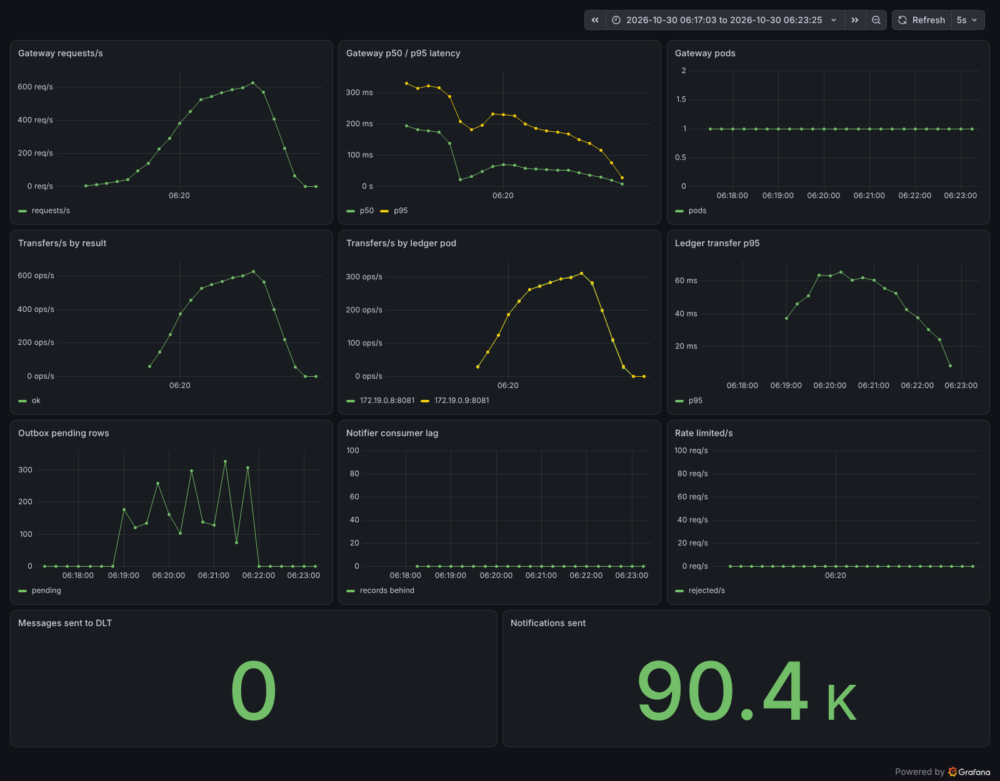
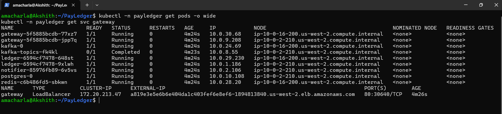

# PayLedger

A payments ledger split into three Spring Boot services. Clients talk GraphQL to a gateway that handles JWT auth, refresh-token rotation and Redis token-bucket rate limiting, and calls the ledger over gRPC. The ledger keeps a double-entry ledger in Postgres and writes every event to an outbox table in the same transaction; a scheduled publisher moves those rows to Kafka, where the notifier consumes them with Redis dedupe, retries and a dead-letter topic. Withdrawals run as a saga on AWS: the ledger holds the money, Step Functions calls a bank Lambda, and the ledger settles or releases the hold through an SQS task-token callback. Prometheus, Grafana and Jaeger watch all three services.

It runs on Docker Compose, on a local kind cluster, and on AWS EKS provisioned with Terraform. All three were run end to end; the numbers below are measured.

```
client ── GraphQL ──> gateway x2 ─────────────> Redis   refresh tokens, token buckets
                        │  JWT (HS256)
                        │  Postgres "auth"
                        │
                        │ gRPC, round_robin over a headless Service
                        v
                      ledger x2 ──────────────> Postgres "ledger"   accounts, transfers, entries, withdrawals, outbox
                        │
                        │ outbox publisher (FOR UPDATE SKIP LOCKED)
                        v
                      Kafka "transfers" (3 partitions)
                        │
                        v
                      notifier ───────────────> Redis   processed:{transferId}
                        │ 3 retries
                        v
                      Kafka "transfers.DLT"

Prometheus + Grafana scrape /actuator/prometheus on every service; the OpenTelemetry agent sends traces to Jaeger.
```

Withdrawal saga (only with `AWS_ENABLED=true`):

```
ledger ── outbox row ("sfn:withdrawal") ──> Step Functions "payledger-withdrawal"
  ^                                           │ CallBank: Lambda "payledger-bank", retries BankUnavailable 3x
  │                                           │ Settle if the bank paid, Release if it did not
  │                                           v
  └── WithdrawalWorker long-polls ──── SQS "withdrawal-actions" (SETTLE / RELEASE + task token)
      updates Postgres, then SendTaskSuccess
```

Java 21, Spring Boot 4.1, grpc-java 1.84, Spring for GraphQL 2.0, spring-kafka 4.1, Kafka 4.4 (KRaft), Postgres 18, Redis 8.10, AWS SDK for Java 2.57, Terraform 1.17 with AWS provider 6.71, EKS 1.36, kind 0.33 (Kubernetes 1.37).

## Run

### Docker Compose

```bash
docker compose up --build -d
until curl -sf localhost:8080/actuator/health >/dev/null; do sleep 2; done
./demo.sh
```

| | |
|---|---|
| GraphQL (GraphiQL at `/graphiql`) | http://localhost:8080/graphql |
| Grafana, dashboard "PayLedger" | http://localhost:3000 |
| Prometheus | http://localhost:9090 |
| Jaeger | http://localhost:16686 |

The ledger runs as two replicas in Compose too; Docker DNS returns both, and the gateway's `round_robin` uses both. Withdrawals are off unless the AWS stack below is running.

Tests use Testcontainers, so they need Docker and JDK 21: `./gradlew test`. CI runs them, builds the images and validates both Terraform stacks on every push.

### kind

kind runs the cluster inside Docker; you need the `kind` and `kubectl` binaries and about 8 GB of memory for Docker. kind needs cgroup v2. On WSL2, put `kernelCommandLine = cgroup_no_v1=all systemd.unified_cgroup_hierarchy=1` under `[wsl2]` in `%USERPROFILE%\.wslconfig` and restart WSL.

```bash
kind create cluster --name payledger --config k8s/overlays/kind/kind-config.yaml
kubectl apply -f https://kind.sigs.k8s.io/examples/ingress/deploy-ingress-nginx.yaml
kubectl apply -f https://github.com/kubernetes-sigs/metrics-server/releases/latest/download/components.yaml
kubectl -n kube-system patch deployment metrics-server --type=json -p '[{"op":"add","path":"/spec/template/spec/containers/0/args/-","value":"--kubelet-insecure-tls"}]'
```

```bash
for s in ledger-service gateway notifier; do docker build -f $s/Dockerfile -t payledger/$s:dev . && kind load docker-image payledger/$s:dev --name payledger; done
kubectl -n ingress-nginx wait --for=condition=ready pod -l app.kubernetes.io/component=controller --timeout=3m
kubectl apply -k k8s/overlays/kind
kubectl -n payledger wait --for=condition=available deployment --all --timeout=10m
RUNTIME=kind ./demo.sh http://localhost/graphql
```

The first deploy pulls every image into the node and can take over 8 minutes. metrics-server feeds the gateway HPA (2 to 4 pods at 70% CPU); the patch lets it talk to kind's self-signed kubelets. Grafana, Prometheus and Jaeger are reachable with `kubectl -n payledger port-forward svc/grafana 3000` (and `svc/prometheus 9090`, `svc/jaeger 16686`). Delete the cluster when you are done (`kind delete cluster --name payledger`); a kind node left running through laptop sleep can stop starting pods.

### AWS withdrawal saga (Compose + real AWS)

Needs an AWS account, the AWS CLI configured with an admin user, and Terraform. At demo volume Lambda, Step Functions and SQS stay in the free tier; the $5 budget is created first. The budget only sends email; it does not stop spending.

```bash
docker run --rm -v "$PWD":/src -w /src eclipse-temurin:21-jdk ./gradlew :bank-lambda:jar --no-daemon
echo 'alert_email = "you@example.com"' > infra/terraform/aws/terraform.tfvars
terraform -chdir=infra/terraform/aws init
terraform -chdir=infra/terraform/aws apply -target=aws_budgets_budget.monthly
terraform -chdir=infra/terraform/aws apply
```

Confirm the SNS subscription email. Then create a user that has only the ledger's policy, so Compose never holds admin keys. The keys go straight into a file that only you can read:

```bash
aws iam create-user --user-name payledger-ledger-local
aws iam attach-user-policy --user-name payledger-ledger-local --policy-arn "$(terraform -chdir=infra/terraform/aws output -raw ledger_policy_arn)"
aws iam create-access-key --user-name payledger-ledger-local --query 'AccessKey.[AccessKeyId,SecretAccessKey]' --output text \
  | (read AK SK; umask 077; printf 'export AWS_ACCESS_KEY_ID=%s\nexport AWS_SECRET_ACCESS_KEY=%s\n' "$AK" "$SK" > ~/.payledger-ledger.env)
```

```bash
source ~/.payledger-ledger.env
export AWS_ENABLED=true AWS_REGION=$(terraform -chdir=infra/terraform/aws output -raw region)
export STATE_MACHINE_ARN=$(terraform -chdir=infra/terraform/aws output -raw state_machine_arn)
export WITHDRAWAL_QUEUE_URL=$(terraform -chdir=infra/terraform/aws output -raw withdrawal_queue_url)
docker compose up -d && ./demo.sh
```

The demo withdraws 1000 cents (settles, unless the fake bank declines it, about 1 in 10) and 666 cents (always released, balance restored). Each run appears in the Step Functions console. Run `unset AWS_ACCESS_KEY_ID AWS_SECRET_ACCESS_KEY` before using Terraform again in the same shell; environment keys override the CLI profile. Without `AWS_ENABLED=true` the `withdraw` mutation returns "withdrawals need AWS_ENABLED=true" and everything else works as before.

### EKS

Apply the AWS saga stack first; the EKS stack reuses its IAM policy for the ledger's IRSA role. A session costs about $0.25 an hour: the EKS control plane ($0.10), two t3.medium nodes ($0.0416 each), the gateway's load balancer (about $0.025), public IPv4 addresses ($0.005 each) and the node disks.

```bash
terraform -chdir=infra/terraform/eks init
terraform -chdir=infra/terraform/eks apply
infra/deploy-eks.sh
RUNTIME=eks ./demo.sh http://GATEWAY_HOST/graphql
```

`deploy-eks.sh` pushes the three images to ECR, fills the placeholders in `k8s/overlays/eks` with Terraform outputs, applies it and prints the gateway URL. Creating the cluster takes about 15 minutes and the deploy about 10. Postgres, Redis and Kafka run in the cluster with `emptyDir` storage (EKS has no volume driver without the EBS CSI add-on); RDS, ElastiCache and MSK are the production choice.

Teardown, in this order. The load balancer belongs to Kubernetes, not Terraform, and blocks the VPC from being deleted. The ledger user's policy attachment blocks the AWS stack from being deleted.

```bash
kubectl -n payledger delete svc gateway
aws elb describe-load-balancers --region us-west-2 --query 'LoadBalancerDescriptions[].LoadBalancerName' --output text   # wait until empty
terraform -chdir=infra/terraform/eks destroy
AK=$(aws iam list-access-keys --user-name payledger-ledger-local --query 'AccessKeyMetadata[0].AccessKeyId' --output text)
aws iam delete-access-key --user-name payledger-ledger-local --access-key-id "$AK"
aws iam detach-user-policy --user-name payledger-ledger-local --policy-arn "$(terraform -chdir=infra/terraform/aws output -raw ledger_policy_arn)"
aws iam delete-user --user-name payledger-ledger-local && rm ~/.payledger-ledger.env
terraform -chdir=infra/terraform/aws destroy
aws resourcegroupstaggingapi get-resources --region us-west-2 --tag-filters Key=Project,Values=payledger
```

The last command should list nothing except, for a while, the EKS KMS key in `PendingDeletion`.

### Load test

```bash
docker run --rm --network host -v "$PWD/loadtest:/scripts" grafana/k6:2.3.0 run -e VUS=50 -e USERS=2000 /scripts/transfers.js
```

Against kind, run k6 on kind's Docker network and go through the ingress:

```bash
docker run --rm --network kind -v "$PWD/loadtest:/scripts" grafana/k6:2.3.0 run \
  -e URL=http://payledger-control-plane/graphql -e VUS=30 -e USERS=500 /scripts/transfers.js
```

## Design notes

**gRPC inside, GraphQL at the edge.** GraphQL lets clients ask for exactly the fields they need in one round trip. Between services, gRPC gives a typed contract, HTTP/2, deadlines (2 s on every call) and status codes that the gateway maps to GraphQL errors.

**Idempotency keys.** `transfers.idempotency_key` and `withdrawals.idempotency_key` are unique. A repeated request returns the original. A concurrent duplicate hits the constraint, its transaction rolls back, and it returns the row that won. This matters because a timeout does not mean failure: on a cold start the gateway's 2 s deadline can expire after the ledger has already committed, and a retry with the same key is safe.

**Lock ordering.** A transfer locks both account rows with `SELECT ... FOR UPDATE` in ascending id order, so A→B and B→A cannot wait on each other. With the ordering removed, the concurrency test fails with Postgres `deadlock detected`.

**Double-entry invariant.** A transfer writes two `entries` rows (−amount, +amount); a deposit writes one; a withdrawal writes a `hold` and, if released, a `release`. `accounts.balance_cents` and `accounts.held_cents` are caches updated in the same transaction. Tests check that every balance equals the sum of its entries and every `held_cents` equals the sum of that account's PENDING withdrawals.

**Outbox, SKIP LOCKED, at-least-once, dedupe.** The event row commits with the transfer, so there is no dual write to Postgres and Kafka. The publisher takes up to 100 unsent rows `FOR UPDATE SKIP LOCKED`, so two ledger replicas take different rows. It sends them, waits for the acks, marks them sent, and keeps going while batches come back full. A crash between ack and commit re-sends rows; the notifier drops repeats with `SET processed:{id} 1 NX EX 604800`.

**Retries and DLT.** `DefaultErrorHandler` retries 3 times (0.5 s, 1 s, 2 s), then `DeadLetterPublishingRecoverer` writes the record to `transfers.DLT` with the exception in its headers. The dedupe claim is released on failure so the retry is not skipped. A transfer of exactly 13 cents fails on purpose to show this path.

**Withdrawal saga.** `withdraw` moves the amount from `balance_cents` to `held_cents`, inserts a PENDING withdrawal and an outbox row in one transaction, and returns at once. The publisher sends that row to Step Functions instead of Kafka. The state machine calls the bank Lambda, retrying `BankUnavailable` 3 times with backoff, then asks the ledger to settle (the hold is dropped because the money left) or release (the hold goes back to the balance).

**Callback with a task token.** Settle and Release use `sqs:sendMessage.waitForTaskToken`: Step Functions puts the action and a token on SQS and waits. The worker applies the action in Postgres, calls `SendTaskSuccess`, then deletes the message. If it dies before the delete, SQS redelivers and the repeat is a no-op because the withdrawal is no longer PENDING. If the token has expired, the worker logs it and still deletes the message.

**Starting the saga once.** The execution name is `withdrawal-<id>-<timestamp>`, stored in the outbox row. A re-sent row reuses the name, and Step Functions does not start a second execution with the same name.

**AWS is opt-in.** With `AWS_ENABLED=false` (the default) the ledger creates no AWS clients, skips saga rows in the outbox, and refuses withdrawals instead of holding money that nothing would release. Compose, CI and the tests need no credentials.

**IRSA and least privilege.** On EKS the ledger pods run as the `ledger` service account; EKS injects a web identity token and the SDK exchanges it for the role's credentials, so the cluster stores no access keys. Only that service account in that namespace can assume the role, and the role only has `StartExecution`, `SendTaskSuccess`, and receive/delete on the queue. Locally the same policy goes on a separate IAM user, which is how the policy was shown to be sufficient.

**Refresh-token rotation.** Refresh tokens are 256-bit random strings stored as `refresh:{token} -> username` with a 7-day TTL. `refresh` uses `GETDEL`, so a token can be exchanged once even when two requests race. Access tokens are HS256 JWTs valid for 15 minutes.

**Token bucket in Lua.** One script reads tokens and the last refill time, refills, takes a token, writes back and sets a TTL. Redis runs it atomically, so 50 concurrent calls let exactly 20 through. It uses Redis `TIME`, so every gateway replica sees the same clock. `register` and `login` are limited per username.

**Database-per-service.** The ledger owns the `ledger` database and the gateway owns `auth`. They share one Postgres server only to keep the setup small. Both ledger replicas run `schema.sql` at startup; a Postgres advisory lock makes the second wait for the first instead of failing with "relation already exists".

**Headless Service for gRPC.** gRPC keeps one long-lived HTTP/2 connection, so behind a ClusterIP Service every call from a gateway pod lands on the same ledger pod. `ledger-headless` returns every pod IP and the client's `round_robin` spreads calls across them. The ledger closes connections after 30 s (`maxConnectionAge`) so clients re-resolve DNS and find new pods. The demo prints transfers per ledger pod, and both serve calls on Compose, kind and EKS.

**Fail-open rate limiter.** If Redis is unreachable the limiter allows the request and logs a warning. Rate limiting protects capacity but correctness does not depend on it, since the ledger validates every transfer. Redis timeouts are 500 ms so an outage fails fast.

**Trace context through the outbox.** The publisher runs on a scheduler thread, so the request's trace would end at the outbox insert. The transfer stores the current W3C `traceparent` in the outbox row; the publisher restores it as the parent while sending and adds it as a Kafka header. One Jaeger trace then shows GraphQL → gRPC → SQL → `transfers publish` → `transfers process` in the notifier. The poll itself runs under an unsampled parent so it does not create a trace every 500 ms.

**One GetAccounts call per page.** `Transfer.from` and `Transfer.to` load through one shared DataLoader, so 20 transfers cost one `GetAccounts` RPC. Two `@BatchMapping` methods would register one loader per field, which makes two calls. Accounts the caller does not own come back with `balanceCents` 0.

## Measured results

### Docker Compose

One 4-vCPU, 15 GB Linux VM; all containers and k6 shared the machine. 50 virtual users (30 s ramp up, 2 min hold, 30 s ramp down) doing 1-cent transfers round-robin over 2000 users.

| | |
|---|---|
| Transfers | 90,358 in the 3-minute scenario, 0 errors, 0 rate limited |
| Client latency | p50 66 ms, p95 205 ms, p99 304 ms, max 979 ms |
| Throughput | 502/s average, 625/s peak (1-minute rate) |
| Ledger replicas | 312/s and 313/s at peak |
| Ledger transfer time (server side) | p95 at most 74 ms |
| Outbox backlog | at most 369 rows; notifier consumer lag 0 |



An earlier run showed the publisher's limit. It drained 100 rows and then always paused 500 ms, which caps two replicas at about 360 rows/s, and the backlog climbed to 41,330 rows while transfers came in at about 720/s. Draining full batches back to back fixed that.

### kind

One kind node under WSL2 with 8 GB of memory on a laptop, k6 running on the same machine, through the ingress. 30 virtual users over 500 users.

| | |
|---|---|
| Gateway HPA | 2 → 4 pods within a minute of the load starting (CPU at about 500% of request); back to 2 after 5 idle minutes |
| Transfers | 36,529 in 3 minutes, 0 errors |
| Client latency | p50 33 ms, p95 369 ms, p99 485 ms, max 7.7 s |
| Requests served | 62,327 (329/s), of which 24,298 were rate limited |

This run is capped by the rate limiter, not by the system: 500 users at 20 transfers a minute allow about 40,000 in 3 minutes. A run started right after the deploy, at 4 gateway pods, had 0.78% failed transfers; a repeat on the warmed cluster had none.

### AWS

The saga and the EKS deployment ran in us-west-2. On EKS (1.36, two t3.medium nodes) the demo passed through the AWS load balancer, both ledger pods served transfers, and withdrawals ran from the pods using only IRSA: 1000 cents SETTLED, 666 cents RELEASED with the balance restored. In Step Functions the settled execution took 2.4 s (consistent with one BankUnavailable retry) and the released one 0.5 s. Everything was destroyed in the same session.



## Known limitations

- No mTLS; gRPC between services is plaintext.
- HS256 with a shared secret instead of an identity provider with asymmetric keys.
- GraphQL `Int` is 32-bit, so amounts and balances above 2,147,483,647 cents fail to serialize. Storage is `bigint`.
- Single-node Kafka, Postgres and Redis. On EKS they use `emptyDir`, so a pod restart loses data.
- The first gateway → ledger call after a fresh deploy can exceed the 2 s deadline while the ledger JVMs warm up, and returns "ledger unavailable". `openAccount` and `deposit` have no idempotency key, so retrying them is not safe.
- Logout revokes the refresh token only; the access token works until it expires. Reusing an old refresh token fails but does not revoke the token family.
- `register` and `login` are limited per username, so repeated bad logins can lock out a real user.
- With two publishers, events for one account can leave the outbox out of order.
- Reusing an idempotency key with different amounts returns the original instead of an error.
- A released withdrawal ends in a Fail state, so the `ExecutionsFailed` alarm also fires on bank rejections.
- The EKS VPC has public subnets only and no NAT gateway, to keep it cheap. Production would put nodes in private subnets.
- ingress-nginx is retired upstream. It is fine for a local kind cluster, not for production.
- Terraform state is local.
