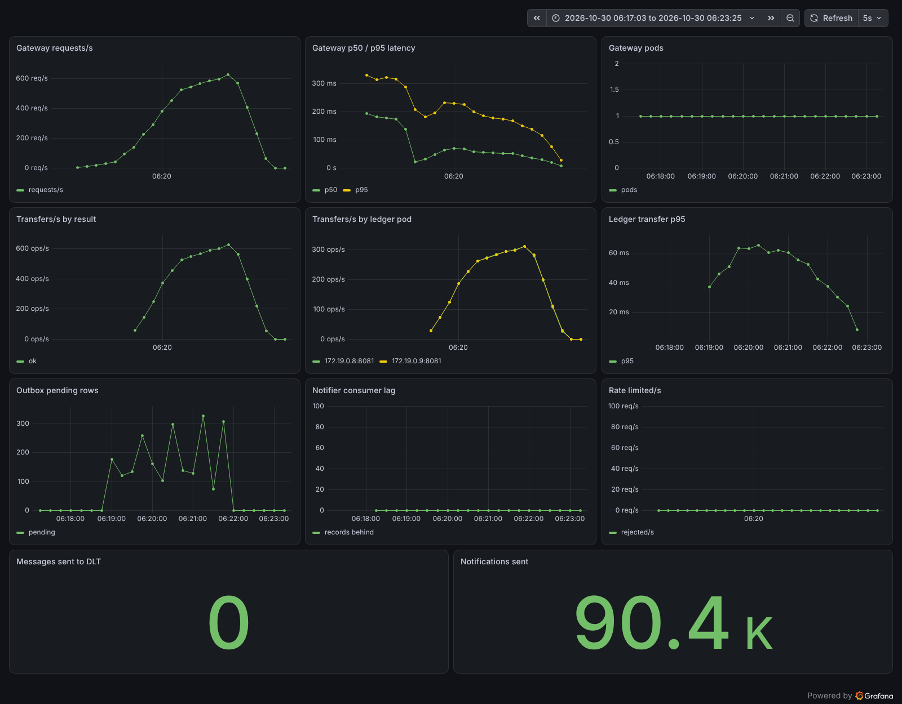

# PayLedger

A payments ledger split into three Spring Boot services. Clients talk GraphQL to a gateway that handles JWT auth, refresh-token rotation and Redis token-bucket rate limiting, and calls the ledger over gRPC. The ledger keeps a double-entry ledger in Postgres and writes every transfer event to an outbox table in the same transaction; a scheduled publisher moves those rows to Kafka, where the notifier consumes them with Redis dedupe, retries and a dead-letter topic. Prometheus, Grafana and Jaeger (through the OpenTelemetry Java agent) watch all three.

```
client ── GraphQL ──> gateway x2 ─────────────> Redis   refresh tokens, token buckets
                        │  JWT (HS256)
                        │  Postgres "auth"
                        │
                        │ gRPC, round_robin over a headless Service
                        v
                      ledger x2 ──────────────> Postgres "ledger"   accounts, transfers, entries, outbox
                        │
                        │ outbox publisher (FOR UPDATE SKIP LOCKED)
                        v
                      Kafka "transfers" (3 partitions)
                        │
                        v
                      notifier ───────────────> Redis   processed:{transferId}
                        │ 3 retries
                        v
                      Kafka "transfers.DLT"

Prometheus + Grafana scrape /actuator/prometheus on every service; the OpenTelemetry agent sends traces to Jaeger.
```

Java 21, Spring Boot 4.1, grpc-java 1.84, Spring for GraphQL 2.0, spring-kafka 4.1, Kafka 4.4 (KRaft), Postgres 18, Redis 8.10.

## Run

### Docker Compose

```bash
docker compose up --build -d
```

```bash
./demo.sh
```

| | |
|---|---|
| GraphQL (GraphiQL at `/graphiql`) | http://localhost:8080/graphql |
| Grafana, dashboard "PayLedger" | http://localhost:3000 |
| Prometheus | http://localhost:9090 |
| Jaeger | http://localhost:16686 |

The ledger runs as two replicas in Compose too; Docker DNS returns both, and the gateway's `round_robin` uses both.

Tests use Testcontainers, so they need Docker and JDK 21: `./gradlew test`. CI runs them on every push.

### kind

kind runs the cluster inside Docker; you need the `kind` and `kubectl` binaries.

```bash
kind create cluster --name payledger --config k8s/overlays/kind/kind-config.yaml
```

```bash
kubectl apply -f https://kind.sigs.k8s.io/examples/ingress/deploy-ingress-nginx.yaml
```

```bash
kubectl apply -f https://github.com/kubernetes-sigs/metrics-server/releases/latest/download/components.yaml
```

```bash
kubectl -n kube-system patch deployment metrics-server --type=json -p '[{"op":"add","path":"/spec/template/spec/containers/0/args/-","value":"--kubelet-insecure-tls"}]'
```

```bash
for s in ledger-service gateway notifier; do docker build -f $s/Dockerfile -t payledger/$s:dev . && kind load docker-image payledger/$s:dev --name payledger; done
```

```bash
kubectl apply -k k8s/overlays/kind
```

```bash
kubectl -n payledger wait --for=condition=available deployment --all --timeout=5m
```

```bash
RUNTIME=kind ./demo.sh http://localhost/graphql
```

metrics-server is needed for the gateway HPA (2 to 4 pods at 70% CPU); the patch lets it talk to kind's self-signed kubelets. Grafana, Prometheus and Jaeger are reachable with `kubectl -n payledger port-forward svc/grafana 3000` (and `svc/prometheus 9090`, `svc/jaeger 16686`).

These manifests pass `kubeconform -strict`, but the kind deployment itself has not been run end to end yet: the machine this was built on could not start nested containers.

### Load test

```bash
docker run --rm --network host -v "$PWD/loadtest:/scripts" grafana/k6:2.3.0 run -e VUS=50 -e USERS=2000 /scripts/transfers.js
```

On Docker Desktop without host networking, drop `--network host` and add `-e URL=http://host.docker.internal:8080/graphql`.

## Design notes

**gRPC inside, GraphQL at the edge.** GraphQL lets clients ask for exactly the fields they need in one round trip. Between services, gRPC gives a typed contract, HTTP/2, deadlines (2 s on every call) and status codes that the gateway maps to GraphQL errors.

**Idempotency keys.** `transfers.idempotency_key` is unique. A repeated request returns the original transfer. A concurrent duplicate hits the constraint, its transaction rolls back, and it returns the row that won. Keys are global, so reusing a key that belongs to someone else's transfer is rejected.

**Lock ordering.** A transfer locks both account rows with `SELECT ... FOR UPDATE` in ascending id order, so A→B and B→A cannot wait on each other. With the ordering removed, the concurrency test fails with Postgres `deadlock detected`.

**Double-entry invariant.** A transfer writes two `entries` rows (−amount, +amount) and a deposit writes one. `accounts.balance_cents` is a cache updated in the same transaction. A test runs random deposits and transfers and checks that every balance equals the sum of its entries.

**Outbox, SKIP LOCKED, at-least-once, dedupe.** The event row commits with the transfer, so there is no dual write to Postgres and Kafka. The publisher takes up to 100 unsent rows `FOR UPDATE SKIP LOCKED`, so two ledger replicas take different rows. It sends them, waits for the acks, marks them sent, and keeps going while batches come back full. A crash between ack and commit re-sends rows; the notifier drops repeats with `SET processed:{id} 1 NX EX 604800`.

**Retries and DLT.** `DefaultErrorHandler` retries 3 times (0.5 s, 1 s, 2 s), then `DeadLetterPublishingRecoverer` writes the record to `transfers.DLT` with the exception in its headers. The dedupe claim is released on failure so the retry is not skipped. A transfer of exactly 13 cents fails on purpose to show this path.

**Refresh-token rotation.** Refresh tokens are 256-bit random strings stored as `refresh:{token} -> username` with a 7-day TTL. `refresh` uses `GETDEL`, so a token can be exchanged once even when two requests race. Access tokens are HS256 JWTs valid for 15 minutes.

**Token bucket in Lua.** One script reads tokens and the last refill time, refills, takes a token, writes back and sets a TTL. Redis runs it atomically, so 50 concurrent calls let exactly 20 through. It uses Redis `TIME`, so every gateway replica sees the same clock. `register` and `login` are limited per username; `refresh` and `logout` are not limited.

**Database-per-service.** The ledger owns the `ledger` database and the gateway owns `auth`. They share one Postgres server only to keep the local setup small.

**Headless Service for gRPC.** gRPC keeps one long-lived HTTP/2 connection, so behind a ClusterIP Service every call from a gateway pod lands on the same ledger pod. `ledger-headless` returns every pod IP and the client's `round_robin` spreads calls across them. The ledger closes connections after 30 s (`maxConnectionAge`) so clients re-resolve DNS and find new pods. In the load test the two replicas served 312 and 313 transfers/s.

**Fail-open rate limiter.** If Redis is unreachable the limiter allows the request and logs a warning. Rate limiting protects capacity but correctness does not depend on it, since the ledger validates every transfer. Redis timeouts are 500 ms so an outage fails fast.

**Trace context through the outbox.** The publisher runs on a scheduler thread, so the request's trace would end at the outbox insert. The transfer stores the current W3C `traceparent` in the outbox row. The publisher restores it as the parent while sending, and also adds it as a Kafka header. One Jaeger trace then shows GraphQL → gRPC → SQL → `transfers publish` → `transfers process` in the notifier. The poll itself runs under an unsampled parent so it does not create a trace every 500 ms.

**One GetAccounts call per page.** `Transfer.from` and `Transfer.to` load through one shared DataLoader, so 20 transfers cost one `GetAccounts` RPC. Two `@BatchMapping` methods would register one loader per field, which makes two calls. Accounts the caller does not own come back with `balanceCents` 0.

## Measured results

Docker Compose on one 4-vCPU, 15 GB Linux VM. All containers and k6 shared the machine. k6 2.3.0, `loadtest/transfers.js` with 50 virtual users (30 s ramp up, 2 min hold, 30 s ramp down) doing 1-cent transfers round-robin over 2000 users.

| | |
|---|---|
| Transfers | 90,358 in the 3-minute scenario, 0 errors, 0 rate limited |
| Client latency | p50 66 ms, p95 205 ms, p99 304 ms, max 979 ms |
| Throughput | 502/s average over the scenario, 625/s peak (1-minute rate) |
| Ledger replicas | 312/s and 313/s at peak |
| Ledger transfer time (server side) | p95 at most 74 ms |
| Outbox backlog | at most 369 rows; notifier consumer lag 0 |



An earlier run showed the publisher's limit. It drained 100 rows and then always paused 500 ms, which caps two replicas at about 360 rows/s. The backlog climbed to 41,330 rows while transfers came in at about 720/s. Draining full batches back to back fixed that. Peak throughput dropped from 723/s to 625/s, because the publisher now competes for the same CPUs.

Not measured yet: the kind cluster and the gateway HPA scaling under load.

## Known limitations

- No mTLS; gRPC between services is plaintext.
- HS256 with a shared secret instead of an identity provider with asymmetric keys.
- GraphQL `Int` is 32-bit, so amounts and balances above 2,147,483,647 cents fail to serialize. Storage is `bigint`.
- Single-node Kafka, Postgres and Redis.
- Logout revokes the refresh token only; the access token works until it expires.
- With two publishers, events for one account can leave the outbox out of order. Consumers must not depend on strict per-account ordering.
- Reusing an idempotency key with different amounts returns the original transfer instead of an error.
- The gateway does not retry ledger calls. If every ledger replica restarts at once, calls fail with "ledger unavailable" until gRPC re-resolves DNS.
- ingress-nginx is retired upstream (no releases since March 2026). It is fine for a local kind cluster, not for production.
- No EKS deployment or Terraform yet.
